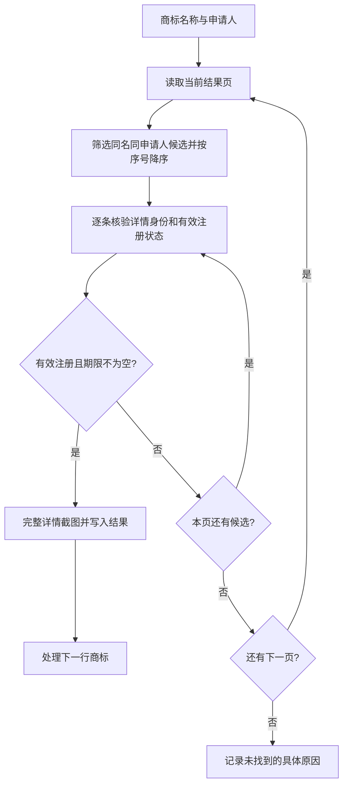
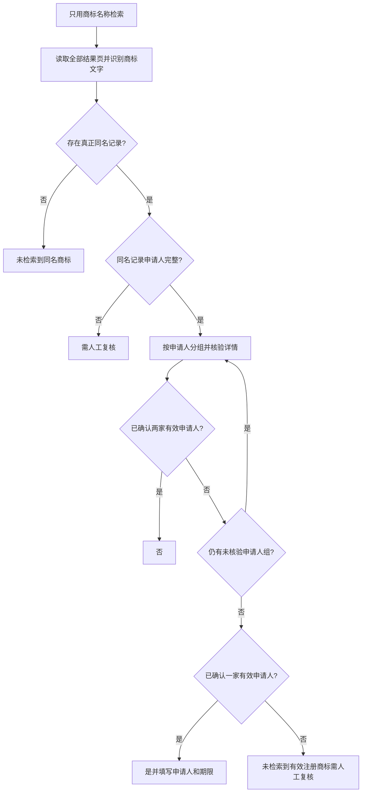

# 商标查询助手

面向员工批量处理 Excel 商标清单的 Windows 桌面应用，支持 **商标申请查询** 和 **商标唯一性查询**。程序使用本机 Microsoft Edge 访问国家知识产权局商标查询网站（CNIPA），核对商标名称、申请人及注册状态，把业务结论和截图证据写入新的 XLSX 结果文件。

员工手动完成网站登录和验证码，启动任务后可以继续使用其他软件；客户端负责展示逐行进度、重试情况和查询结果。

**当前源码版本：0.1.30。** 本说明按当前代码及项目相关需求、排障、迭代记录整理。GitHub 仓库保存的是移除真实 API 密钥后的源码快照，不包含本机安装包、业务 Excel、浏览器登录资料和历史任务数据。自行构建后，需要在“模型设置”中填写自己的 API Key，才能使用远程图片识别兜底。

## 目录

- [主要功能](#主要功能)
- [两种查询模式](#两种查询模式)
- [Excel 输入要求](#excel-输入要求)
- [员工操作流程](#员工操作流程)
- [商标申请查询规则](#商标申请查询规则)
- [商标唯一性查询规则](#商标唯一性查询规则)
- [名称匹配与图片识别](#名称匹配与图片识别)
- [输出表格与截图证据](#输出表格与截图证据)
- [异常恢复、暂停与断点](#异常恢复暂停与断点)
- [已完成的主要优化](#已完成的主要优化)
- [架构与源码位置](#架构与源码位置)
- [开发环境与启动](#开发环境与启动)
- [测试、构建与发版](#测试构建与发版)
- [本地数据与模型配置](#本地数据与模型配置)
- [常见问题与维护资料](#常见问题与维护资料)

## 主要功能

| 能力 | 当前行为 |
| --- | --- |
| 批量商标申请查询 | 根据“商标名称＋申请人”逐页核验，找到有效注册且有专用权期限的记录后停止翻页 |
| 批量商标唯一性查询 | 收集全部分页的同名结果，按申请人分组并核验有效注册状态，输出唯一性结论 |
| Excel 模板识别 | 按表头识别模式和列位置，不依赖文件名或固定列序 |
| 图片商标识别 | 网页文字优先，本地 RapidOCR 其次，无法可靠确认时使用多模态模型 |
| 后台查询和截图 | 专用 Edge 在屏幕外保持渲染，客户端显示当前行、查询阶段和分页进度 |
| 批量容错 | 单条技术异常先跳过，首轮结束后自动重试一次 |
| 进度保留 | 逐行保存结果和检查点，支持暂停、继续及断点恢复 |
| 结果复核 | 输出详情或结果行截图、失败原因、“是否调用大模型”和执行记录 |
| 独立安装 | Vue 3＋Tauri 2 桌面壳，随安装包附带 Python Worker 和 OCR 资源 |

程序独立于 BuddyAgent、监控告警等其他项目运行，不依赖它们的目录、后端、数据库、MQTT、技能或 SOP。同一台电脑同一时间只运行一个 Worker／商标任务；不同员工可以在各自电脑上分别查询。

## 两种查询模式

| 对比项 | 商标申请查询（普通商标查询） | 商标唯一性查询 |
| --- | --- | --- |
| 业务目标 | 找到指定申请人名下符合条件的同名有效注册记录 | 判断同名商标中有有效注册记录的申请人是否只有一家 |
| 网站检索条件 | 商标名称＋申请人 | 只填商标名称，不限制申请人 |
| 分页策略 | 逐页处理，当前页命中后立即停止 | 必须先读取全部结果页 |
| 详情核验 | 页内候选按网站序号降序检查 | 按申请人分组，每组按序号降序检查 |
| 成功输出 | 申请人、专用权期限、详情截图、“查询结果＝成功” | 唯一性结论、代表记录截图；为“是”时补充申请人和期限 |

这里的“唯一性”具体指 **当前检索到的同名记录中，拥有有效注册记录的申请人主体数量**。同一申请人有多个注册号或多个分类记录，仍按一家统计。当前查询不设置指定国际分类，也不做商标近似、图形相似或关联企业合并判断。

## Excel 输入要求

只接受 `.xlsx`，不接受旧版 `.xls`。表头放在第一行，第二行开始填写商标清单。程序处理第一个第一行有非空表头的工作表，不会自动合并多个工作表的任务。

### 商标申请查询模板

| 商标名称 | 商标申请人 | 专用权期限 | 截图 |
| --- | --- | --- | --- |
| 示例商标 | 示例有限公司 | 留空，等待查询 | 留空，等待查询 |

- “商标名称”和“商标申请人”是输入；待查询行缺少申请人会报错。
- “专用权期限”也可使用“商标有效期”表头。
- 不要加入“是否唯一性”列，否则会被识别为唯一性查询模式。

### 商标唯一性查询模板

| 商标名称 | 是否唯一性 | 商标申请人 | 商标有效期 | 截图 |
| --- | --- | --- | --- | --- |
| 示例商标 | 留空，等待查询 | 留空，等待查询 | 留空，等待查询 | 留空，等待查询 |

- 只需提供商标名称；申请人、有效期和唯一性列是输出位置。
- “商标有效期”也可使用“专用权期限”表头。
- 是否进入唯一性模式由“是否唯一性”表头决定，不由文件名决定。

### 共用要求

- 表头会做全半角、空白和部分标点标准化，支持规定表头后附加说明；列顺序可以调整，但必需列不能缺失。
- 商标名称应是单元格中可读取的文字。结果网页的图片商标有识别支持，不代表输入 Excel 中只有图片的行也会自动识别。
- 商标名称为空的行跳过。普通查询的期限列、唯一性查询的“是否唯一性”列已有内容时，界面默认不重复查询该行。
- 仓库不附带员工业务表格，可以按上面的表头自行创建空白模板。

## 员工操作流程

1. 安装并打开“商标查询助手”。员工使用安装版时不需要自行安装 Python、Node.js 或 Rust；电脑需有 Microsoft Edge，桌面界面需要 WebView2 Runtime。
2. 选择 XLSX，确认识别出的任务类型、商标清单和申请人。客户端显示待查询行及后续执行阶段。
3. 点击“打开商标网站”。程序启动或接回自己的专用 Edge，打开 CNIPA 首页。
4. 在专用 Edge 中点击网站的“商标综合查询”入口，按网站要求手动登录、输入验证码。账号、密码和验证码由网站及 Edge 处理。
5. 登录后回到客户端，点击“我已登录，检查并进入查询”。等待状态变为“可以开始”，再点击“开始查询”。不要仅根据浏览器看起来已登录就直接认为查询连接已就绪。
6. 查询开始后，专用 Edge 移到屏幕外继续渲染；可以使用其他软件。需要观察时，点击“查看查询过程”恢复窗口。
7. 根据需要使用“暂停任务”“继续”“取消任务”。登录或人工验证导致暂停时，先在专用 Edge 处理，再确认连接并继续。
8. 完成后点击“另存为”，选择结果 XLSX 的保存位置。暂停或取消后，也可在客户端允许保存时另存已完成部分。

任务查询过程中尽量不要自行关闭或最小化专用 Edge，不要手动切换其正在查询的标签页。它与员工日常使用的 Edge 采用不同资料目录。

## 商标申请查询规则

用于核实 Excel 指定的商标与申请人组合，并取得符合当前规则的有效注册详情。

1. 将商标名称填入检索要素；申请人含汉字时填写中文申请人字段，否则填写英文申请人字段。
2. 从第一页开始读取结果。商标格只有图片时先完成文字识别。
3. 在当前页筛选商标名称及标准化后申请人都一致的记录，按网站“序号”从大到小排列。
4. 逐条进入详情，核对申请人一致，并确认注册号一致或商标名称匹配。
5. 详情状态标准化后必须同时包含 `issued and active` 和“注册商标”，且专用权期限不为空。
6. 命中第一条合格详情后保存完整详情截图、写入结果，然后处理 Excel 的下一行，不再读取后续页。
7. 当前页无合格记录时进入下一页；所有页面都未命中时记录具体未找到原因。



候选优先级是“页码优先、页内序号降序”，不会先收集全站结果再做全局排序。网站状态文字未读到、页面超时等技术问题会进入恢复或重试路径；明确读到非有效状态才按业务不符合处理。

当前有效性判断依据网站详情状态及期限字段是否存在，不另外按本机日期重新计算期限是否过期。没有同名同申请人记录、详情身份不匹配、非有效注册、有效注册但期限为空，都会分别记录原因。

## 商标唯一性查询规则

用于判断 **同名商标是否仅有一家申请人拥有有效注册记录**，不能仅通过列表中的记录数量或所有申请人数直接下结论。

### 查询与核验流程

1. 只用商标名称发起查询，不填申请人，避免漏掉其他主体。
2. 读取全部分页，并识别图片商标；按名称匹配规则保留真正同名的记录。
3. 按标准化后的申请人名称分组。同名记录中存在空白申请人时返回“需人工复核”。
4. 每个申请人组内按网站序号降序进入详情，核验详情身份和有效注册状态；找到一条有效注册记录就停止检查该申请人的其余候选。
5. 已确认两家申请人有有效注册记录时，可以立即判定“否”，不必继续打开其他申请人的详情。但前面的结果分页仍然全部读取。
6. 只确认一家有效申请人时，输出“是”，并写入该组命中的详情申请人和专用权期限。
7. 选择支撑结论的代表记录，裁剪列表行、纵向拼接，嵌入 Excel。



### 结果含义

| 检索和核验情况 | “是否唯一性”列 | 申请人／有效期 |
| --- | --- | --- |
| 没有任何符合名称规则的同名结果 | 未检索到同名商标 | 留空 |
| 同名结果中存在空白申请人 | 需人工复核 | 留空 |
| 有同名结果，但未确认任何有效注册记录 | 未检索到有效注册商标，需人工复核 | 留空 |
| 仅一家申请人有有效注册记录 | 是 | 写入命中详情的申请人、期限 |
| 至少两家不同申请人有有效注册记录 | 否 | 留空 |

例如，甲公司有 10 条有效注册记录，乙公司有 3 条同名记录但详情均非有效注册，结论为“是”；甲、乙各有一条有效注册记录，结论为“否”。同一家公司名称中的空格或中英文括号差异不会被算作两家公司。

唯一性核验要求有效注册状态，但不像普通查询那样把“专用权期限非空”作为独立前置条件，因此“是”的期限字段仍可能为空。网站超时、HTTP 错误或图片识别失败会进入异常重试，不应直接解释成“否”或商标不存在。

### 唯一性证据范围

- 当前最多选取 **4 条代表性列表记录**，不是全部同名结果，也不是每个商标都保存全部详情。
- 为“否”时，优先包括两家已核验有效申请人的命中记录，再按需要补充同主体的代表记录。
- 为“是”时，从唯一有效申请人的同名记录中选取，并确保包括实际核验有效的候选。
- 申请人缺失或未确认有效注册时，从同名记录中选取代表行，供人工检查。没有同名记录时没有可截取的列表行。
- 证据按所选记录裁剪并纵向拼接，条件允许时附上结果表头和页尾。

具体结论取自 [`task_engine.py`](worker/src/trademark_worker/task_engine.py) 的 `_run_uniqueness`。[`selection.py`](worker/src/trademark_worker/selection.py) 里的 `decide_uniqueness` 是列表分组辅助规则，不能单独代表当前完整的详情核验流程。

## 名称匹配与图片识别

### 名称匹配

- 商标名称先做 Unicode NFKC 标准化、压缩重复空白并忽略英文大小写。
- 纯中文查询词按汉字序列比较，可以忽略图片附带的拼音、拉丁副标题或换行；额外汉字仍会导致不匹配。例如“风行”和“风行科技”不同。
- 查询词含英文或数字时按标准化后的完整内容比较，不把不同中英文混合商标合并。
- 申请人名称做 NFKC 标准化、忽略大小写和全部空白，统一中英文括号；不删除“有限公司”等主体字样，不按简称或关联关系合并企业。

实现见 [`normalization.py`](worker/src/trademark_worker/normalization.py)，候选筛选见 [`selection.py`](worker/src/trademark_worker/selection.py)。

### 图片识别顺序

```text
结果网页有可读取商标文字 → 直接读取
结果网页只有商标图片     → 本地 RapidOCR
本地结果不可靠或无法确认 → 配置的远程多模态模型兜底
```

本地 OCR 延迟加载，减少普通启动等待；按注册号缓存识别结果，减少重复识别。远程图片识别按批处理，仍不完整时有一次针对未识别项的补认，不会因 OCR 异常不断刷新整张结果表。

远程模型需要支持图片输入。调用会把待识别的商标结果图片发送到配置的服务；纯网页文字读取和本地 OCR 不需要远程模型调用。识别失败与网站接口异常属于不同故障来源，应按实际错误定位。

## 输出表格与截图证据

程序先复制原表到任务目录，保留输入快照，再修改结果工作副本；不直接修改员工选中的原始 XLSX。默认结果文件名追加 `_已查询`，另存时可自行命名，不能覆盖原始输入文件。

| 模式／字段 | 写入内容 |
| --- | --- |
| 普通查询：商标申请人 | 成功时写入详情中的申请人 |
| 普通查询：专用权期限／商标有效期 | 成功时写入详情中的期限 |
| 普通查询：截图 | 成功时嵌入完整详情图；最终未找到或失败时写入具体错误原因 |
| 普通查询：查询结果 | 在“截图”右侧增加该列；查到符合条件的有效记录时填“成功”，其他情况留空 |
| 唯一性查询：是否唯一性 | 写入上面结果表中的五种结论之一 |
| 唯一性查询：申请人、有效期 | 只有结论为“是”时填写；其他已得出结论的行清空这些输出位置 |
| 唯一性查询：截图 | 代表性结果行的拼接图；最终技术异常时写入错误原因 |
| 两种模式：是否调用大模型 | 按输入行记“是／否”；只要曾发起远程请求，即使识别失败或后续重试也保留“是”；尚未处理的行留空 |

结果文件还增加“查询执行记录”工作表，记录 **原行号、商标、最终状态、尝试次数、说明**。注册号用于详情身份核对，并保留在任务结果数据及截图中，当前不会自动新增独立的 Excel 注册号列。

截图以原始像素写入 XLSX，只缩放 Excel 内的显示尺寸并调整行高、列宽；长图可放大或提取原图查看。普通查询取详情证据，唯一性查询取代表行证据。

“任务完成／已完成”表示该行流程已产出结果，不保证唯一性为“是”。“未查到有效商标”属于业务结果，“需处理”则应结合错误原因区分业务未命中、网站故障或识别异常。

## 异常恢复、暂停与断点

| 情况 | 当前处理方式 |
| --- | --- |
| 页面显示“已过期” | 每次等待 1 秒后刷新；当前恢复步骤最多刷新 10 次，仍不成功才向任务层报告异常 |
| 检索结果接口首次 HTTP 403 | 等待约 3 秒并刷新重试一次；仍为 403 则报告异常 |
| 单条普通技术异常 | 首轮记录“等待重试”并继续后续行；首轮结束后重试该行一次，仍失败则写最终原因 |
| 明确未命中业务条件 | 直接记录未找到原因，不当成临时技术异常反复查询 |
| 明确需要重新登录、验证码或认证操作 | 保存进度并暂停，员工处理后继续 |
| 用户点击暂停／取消 | 在安全边界处理，可能需要等待当前查询步骤完成；已完成结果保留 |
| 恢复已有任务 | 校验输入文件 SHA256，跳过检查点中已完成行；原始输入被修改时拒绝直接恢复 |

**“最多刷新 10 次”是各处过期恢复步骤的上限，不是整个商标任务的总刷新次数。** 一行可能经历结果页、翻页、多个详情候选、截图及末轮重试，所以可观察到多次刷新；程序没有无限刷新直到成功的承诺。

首轮等待重试的行，其业务结果可能暂时空白，后面的行仍可先完成。判断是否真的执行第二轮，可查看“查询执行记录”的尝试次数；不要仅根据某个界面轮次标签判断。

## 已完成的主要优化

以下归纳项目相关迭代中已经进入当前源码的改进，具体行为以前面的规则和实际代码为准。

| 反馈问题 | 当前改进 |
| --- | --- |
| Edge 已打开却显示未连接、登录窗口不可见 | 按专用资料目录定位实际 Edge 进程，复用会话，登录阶段恢复可见窗口，改进新 Edge 的界面检测兼容性 |
| 查询时抢前台、窗口遮挡或最小化影响截图 | 专用 Edge 在屏幕外继续渲染，通过本机页面通道查询和取图，并校验截图内容 |
| 已登录但查询页面未真正就绪 | 使用网站首页入口并综合核对页面、表单、登录和跳转状态 |
| 普通商标有大量分页，必须读完才能核验 | 改成逐页筛选，页内序号降序，命中即停止读取后续页 |
| 唯一性只看申请人数容易误判 | 收集全分页同名结果，按申请人分组核验有效注册；确认两家后停止多余详情检查 |
| 中文商标带拼音导致误判，远程识别慢 | 加入本地 RapidOCR、中文名称规则、识别缓存和远程批量兜底 |
| 页面过期、HTTP 403、翻页内容未更新 | 增加有限恢复、页码与结果内容校验，页面过期等待 1 秒，当前步骤最多刷新 10 次 |
| 某条异常导致整批停止，已完成结果丢失 | 技术异常先跳过、末轮重试、逐行保存和检查点；人工验证时暂停恢复 |
| 详情商标状态未加载就判定无效 | 等待状态完整加载，读取异常走恢复／重试，明确非有效状态才作为业务未命中 |
| 申请人空格、括号差异导致不匹配 | 忽略申请人全部空白、统一全半角及括号，保持主体名称严格匹配 |
| 输出空白难排查，长截图不清楚 | 增加普通查询“查询结果”、两种模式“是否调用大模型”、执行记录、最终错误原因，保留图片原始像素 |
| 源表只读、安装版资源或版本不一致 | 工作副本改为可写，规范 Worker 资源暂存、版本检查及冻结包 OCR／浏览器协议自检 |

这些优化减少了不必要的网络识别、详情访问和重复查询，但实际耗时仍受网站响应、分页数、候选数量和图片识别情况影响，没有统一的速度倍数保证。

## 架构与源码位置

```text
Vue 3 / TypeScript 界面
        │ Tauri invoke / worker-event
        ▼
Tauri 2 / Rust 桌面壳
        │ stdin/stdout NDJSON，一行一个 JSON
        ▼
Python 3.11 Worker
        ├─ XLSX 模板识别、业务判断、证据写入、检查点
        ├─ 网页文字、本地 OCR、远程多模态识别
        └─ UI Automation + 本机回环页面通道
                         ▼
                  专用 Microsoft Edge → CNIPA 网站
```

应用使用机器上已安装的 Edge，不打包 Chromium；不使用 WebDriver，不启用 `--enable-automation`。网站登录资料保存在独立浏览器配置目录。页面连接和截图通过本机回环通道完成；源码使用 Playwright 等库不意味着安装了额外浏览器供员工使用。

| 目录／文件 | 职责 |
| --- | --- |
| [`apps/desktop/src/App.vue`](apps/desktop/src/App.vue) | 主界面入口 |
| [`apps/desktop/src/composables/useTrademarkTask.ts`](apps/desktop/src/composables/useTrademarkTask.ts) | 任务操作和 Worker 事件转界面状态 |
| [`apps/desktop/src-tauri/src/`](apps/desktop/src-tauri/src/) | Rust 入口、Worker 生命周期、文件对话框、模型设置 |
| [`worker/src/trademark_worker/__main__.py`](worker/src/trademark_worker/__main__.py) | Worker 进程入口与单实例锁 |
| [`worker/src/trademark_worker/task_engine.py`](worker/src/trademark_worker/task_engine.py) | 两类查询业务、逐行执行、重试与恢复 |
| [`worker/src/trademark_worker/cnipa/client.py`](worker/src/trademark_worker/cnipa/client.py) | 查询、分页、详情及证据编排 |
| [`worker/src/trademark_worker/browser/`](worker/src/trademark_worker/browser/) | Edge 生命周期、页面状态、后台操作及截图 |
| [`worker/src/trademark_worker/local_ocr.py`](worker/src/trademark_worker/local_ocr.py) | 本地 RapidOCR |
| [`worker/src/trademark_worker/vision.py`](worker/src/trademark_worker/vision.py) | 远程多模态识别 |
| [`worker/src/trademark_worker/workbook/`](worker/src/trademark_worker/workbook/) | 输入检查、结果写入及执行记录 |
| [`worker/tests/`](worker/tests/) | Worker 单元测试、页面 fixtures 和离线端到端测试 |
| [`scripts/`](scripts/) | 环境初始化、构建、暂存、冒烟及发布校验脚本 |
| [`docs/`](docs/) | 历史设计、维护交接及界面资料 |

## 开发环境与启动

目标系统为 Windows 10／11 x64。开发需 Python 3.11（带 `py` 启动器）、Node.js／npm、Rust MSVC 工具链、Visual Studio C++ Build Tools（含 Windows SDK）、Microsoft Edge 和 WebView2 Runtime。首次恢复依赖和编译需要联网。

在项目根目录运行已有初始化脚本：

```powershell
powershell -NoProfile -ExecutionPolicy Bypass -File scripts\setup-home-dev.ps1
```

该脚本检查开发工具、创建 `worker/.venv`、安装 Python 和 npm 依赖、构建 Worker 并暂存桌面资源，不会自动安装系统工具。不要直接复制其他电脑的虚拟环境或 Rust 编译缓存。

只需手动恢复源码依赖时：

```powershell
py -3.11 -m venv worker\.venv
worker\.venv\Scripts\python.exe -m pip install -e "worker[dev]"
npm --prefix apps\desktop ci
```

关闭已安装的商标查询助手，避免占用单实例锁，再启动开发版：

```powershell
Set-Location apps\desktop
npm run tauri -- dev
```

## 测试、构建与发版

在项目根目录运行：

```powershell
worker\.venv\Scripts\python.exe -m pytest worker\tests -q
npm --prefix apps\desktop test -- --run
npm --prefix apps\desktop run build
cargo test --manifest-path apps\desktop\src-tauri\Cargo.toml
```

Worker 测试包含已打包可执行文件相关检查，因此完整测试前应先完成 Worker 构建／初始化。旧安装版或残留 Worker 占用单实例锁、旧冻结包与源码版本不同，都可能影响环境依赖测试。

构建 Windows 当前用户安装的 NSIS 安装包：

```powershell
powershell -NoProfile -ExecutionPolicy Bypass -File scripts\build-desktop.ps1
powershell -NoProfile -ExecutionPolicy Bypass -File scripts\smoke-test.ps1
```

构建流程先用 PyInstaller 打包 Python Worker，检查版本和冻结包 OCR／浏览器协议启动，再暂存 Tauri 资源，执行前端及 Rust 测试，最后构建桌面安装包。完整 Python 测试需按上面的命令单独运行。

当前版本安装包输出位置：

```text
apps/desktop/src-tauri/target/release/bundle/nsis/商标查询助手_0.1.30_x64-setup.exe
```

安装包 `.exe` 会安装桌面主程序、Worker 和所需资源，不能只复制主程序 `.exe` 就当作完整应用。升级前应关闭旧版，并确认没有残留 `trademark-worker.exe` 占用安装文件。

自动化测试、包内资源自检和文件校验不等于真实网站验收。发版前仍需手动登录，验证申请查询、跨页唯一性、图片识别、后台截图、暂停恢复、失败重试和另存结果。

## 本地数据与模型配置

| 位置 | 内容 |
| --- | --- |
| `%LOCALAPPDATA%\TrademarkQueryDesktop\edge-profile` | 专用 Edge 登录资料 |
| `%LOCALAPPDATA%\TrademarkQueryDesktop\settings.json` | 接口 URL、API Key、模型名 |
| `%LOCALAPPDATA%\TrademarkQueryDesktop\tasks\<run_id>\input` | 原始输入快照 |
| 同一任务目录下 `output` | 持续更新的结果工作副本 |
| 同一任务目录下 `evidence` | 详情、列表行和拼接证据图 |
| 同一任务目录下 `request.json`、`checkpoint.json`、`result.json` | 请求、断点和任务结果 |

在客户端右上角“模型设置”填写服务的 URL、API Key 和支持图片输入的模型名。配置字段为 `DASHSCOPE_BASE_URL`、`DASHSCOPE_API_KEY`、`DASHSCOPE_MODEL`；默认接口为 DashScope 的 OpenAI 兼容接口，当前默认模型名为 `qwen3.7-plus`，可在界面修改。

GitHub 源码中的 `YOUR_API_KEY` 是占位值，不是可调用的密钥。历史内部发行版曾预置公司配置，因此部分旧界面文案和交接资料仍写着“无需修改”；从本仓库自行构建时，应以本节为准。

配置文件保存在本机，界面遮罩不等于文件加密。不要把真实密钥、浏览器资料、Cookie、员工业务表格、任务截图或诊断日志提交到 GitHub；源码仓库保持私有也不能代替密钥管理。

应用不读取、保存或自动填写 CNIPA 账号密码和验证码。查询依赖网站与用户登录状态；使用远程识别时另需对应模型服务的可用配置。当前没有独立服务端、共享账号系统或自动更新服务。

## 常见问题与维护资料

| 现象 | 检查与处理 |
| --- | --- |
| 已在浏览器登录，客户端仍未就绪 | 确认使用查询专用 Edge，从首页进入商标综合查询，再点击客户端的登录检查按钮 |
| 暂停／取消后仍显示处理中 | 当前步骤可能尚未结束，安全暂停并非强制立即终止；已完成行仍会保留 |
| 某行暂时没有结果，后面的行已完成 | 可能在首轮等待重试；看执行记录和尝试次数，再确认整批是否完成 |
| 唯一性显示“否” | 至少两家申请人通过有效注册核验，不是程序查询失败 |
| 唯一性“需人工复核”或未找到有效注册 | 查看代表截图及结论原因，不能直接等同于“否” |
| HTTP 403／502、页面过期或识别超时 | 区分商标网响应与模型服务错误；最终原因写入截图列和执行记录，不能据此断言商标不存在 |
| “是否调用大模型＝是”但该行失败 | 该列只说明曾发起模型请求，不说明模型识别或业务查询一定成功 |
| 新电脑源码能打开却不能运行 | 恢复依赖、构建 Worker、确认 Edge／WebView2 和模型配置，不要依赖旧电脑绝对路径 |
| 安装提示文件占用 | 关闭旧客户端和残留 Worker 后再升级，保留已完成的结果 |

补充资料：

- [项目交接文档](docs/项目交接文档.md)：架构、模块和排障入口，主要记录 0.1.10 阶段。
- [回家继续开发](docs/回家继续开发.md)：新电脑初始化和旧交接包说明，主要记录 0.1.26 阶段。
- [最初设计规格](docs/superpowers/specs/2026-09-09-trademark-query-desktop-design.md) 与 [后台运行设计](docs/superpowers/specs/2026-09-11-background-resilient-batch-design.md)：历史需求背景。
- [界面规格](docs/design/trademark-query-ui-spec.md)：界面设计资料。

这些历史资料中的旧版本号、电脑绝对路径、“截取全部同名行”以及预置公司密钥等描述不能直接当作当前行为。发生差异时，以本 README、当前源码和针对性验证为准。
